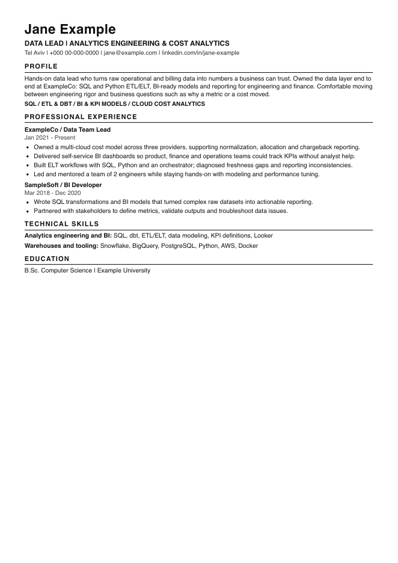
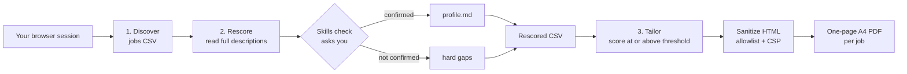

<p align="center">
  
</p>

# linkedin-top-applicant

[](LICENSE)
[](https://github.com/adamorad/linkedin-top-applicant-skill/commits/main)
[](https://github.com/adamorad/linkedin-top-applicant-skill/stargazers)

**Find the LinkedIn jobs you'd rank near the top for, then get a one-page tailored CV for each.**

A coding-agent skill that turns your logged-in LinkedIn session into a ranked job shortlist and a folder of tailored A4 CVs. It finds jobs where you would be a top applicant, rescores them against your CV after an explicit skills check, and renders a PDF for each strong match.

It is read only. It never applies, saves, follows or messages anyone.

## Install

Pick your agent. Each button jumps to the exact command.

<p align="center">
<a href="#install-claude-code"></a>
<a href="#install-codex"></a>
<a href="#install-cursor"></a>
<a href="#install-gemini-cli"></a>
<a href="#install-github-copilot"></a>
<a href="#install-opencode"></a>
<a href="#install-windsurf"></a>
<a href="#install-cline"></a>
<a href="#install-amp"></a>
<a href="#install-goose"></a>
<a href="#install-roo"></a>
<a href="#install-continue"></a>
<a href="#install-antigravity"></a>
<a href="#install-trae"></a>
<a href="#install-kilo"></a>
<a href="#install-droid"></a>
<a href="#install-pi"></a>
</p>

Or install for every supported agent at once:

```bash
npx skills add https://github.com/adamorad/linkedin-top-applicant-skill --skill linkedin-top-applicant --agent '*'
```

<details>
<summary><b>Plain git clone, no installer</b></summary>

```bash
git clone https://github.com/adamorad/linkedin-top-applicant-skill.git
ln -s "$PWD/linkedin-top-applicant-skill/skills/linkedin-top-applicant" ~/.claude/skills/linkedin-top-applicant
```

Use `~/.agents/skills/` instead of `~/.claude/skills/` for agents that read the shared `.agents` folder.

</details>

<details id="install-claude-code">
<summary><b>Claude Code</b></summary>

```bash
npx skills add https://github.com/adamorad/linkedin-top-applicant-skill --skill linkedin-top-applicant --agent claude-code
```

Add `--global` for a user-level install.

</details>

<details id="install-codex">
<summary><b>Codex</b></summary>

```bash
npx skills add https://github.com/adamorad/linkedin-top-applicant-skill --skill linkedin-top-applicant --agent codex
```

Add `--global` for a user-level install.

</details>

<details id="install-cursor">
<summary><b>Cursor</b></summary>

```bash
npx skills add https://github.com/adamorad/linkedin-top-applicant-skill --skill linkedin-top-applicant --agent cursor
```

Add `--global` for a user-level install.

</details>

<details id="install-gemini-cli">
<summary><b>Gemini CLI</b></summary>

```bash
npx skills add https://github.com/adamorad/linkedin-top-applicant-skill --skill linkedin-top-applicant --agent gemini-cli
```

Add `--global` for a user-level install.

</details>

<details id="install-github-copilot">
<summary><b>GitHub Copilot</b></summary>

```bash
npx skills add https://github.com/adamorad/linkedin-top-applicant-skill --skill linkedin-top-applicant --agent github-copilot
```

Add `--global` for a user-level install.

</details>

<details id="install-opencode">
<summary><b>OpenCode</b></summary>

```bash
npx skills add https://github.com/adamorad/linkedin-top-applicant-skill --skill linkedin-top-applicant --agent opencode
```

Add `--global` for a user-level install.

</details>

<details id="install-windsurf">
<summary><b>Windsurf</b></summary>

```bash
npx skills add https://github.com/adamorad/linkedin-top-applicant-skill --skill linkedin-top-applicant --agent windsurf
```

Add `--global` for a user-level install.

</details>

<details id="install-cline">
<summary><b>Cline</b></summary>

```bash
npx skills add https://github.com/adamorad/linkedin-top-applicant-skill --skill linkedin-top-applicant --agent cline
```

Add `--global` for a user-level install.

</details>

<details id="install-amp">
<summary><b>Amp</b></summary>

```bash
npx skills add https://github.com/adamorad/linkedin-top-applicant-skill --skill linkedin-top-applicant --agent amp
```

Add `--global` for a user-level install.

</details>

<details id="install-goose">
<summary><b>Goose</b></summary>

```bash
npx skills add https://github.com/adamorad/linkedin-top-applicant-skill --skill linkedin-top-applicant --agent goose
```

Add `--global` for a user-level install.

</details>

<details id="install-roo">
<summary><b>Roo Code</b></summary>

```bash
npx skills add https://github.com/adamorad/linkedin-top-applicant-skill --skill linkedin-top-applicant --agent roo
```

Add `--global` for a user-level install.

</details>

<details id="install-continue">
<summary><b>Continue</b></summary>

```bash
npx skills add https://github.com/adamorad/linkedin-top-applicant-skill --skill linkedin-top-applicant --agent continue
```

Add `--global` for a user-level install.

</details>

<details id="install-antigravity">
<summary><b>Antigravity</b></summary>

```bash
npx skills add https://github.com/adamorad/linkedin-top-applicant-skill --skill linkedin-top-applicant --agent antigravity
```

Add `--global` for a user-level install.

</details>

<details id="install-trae">
<summary><b>Trae</b></summary>

```bash
npx skills add https://github.com/adamorad/linkedin-top-applicant-skill --skill linkedin-top-applicant --agent trae
```

Add `--global` for a user-level install.

</details>

<details id="install-kilo">
<summary><b>Kilo Code</b></summary>

```bash
npx skills add https://github.com/adamorad/linkedin-top-applicant-skill --skill linkedin-top-applicant --agent kilo
```

Add `--global` for a user-level install.

</details>

<details id="install-droid">
<summary><b>Droid</b></summary>

```bash
npx skills add https://github.com/adamorad/linkedin-top-applicant-skill --skill linkedin-top-applicant --agent droid
```

Add `--global` for a user-level install.

</details>

<details id="install-pi">
<summary><b>Pi</b></summary>

```bash
npx skills add https://github.com/adamorad/linkedin-top-applicant-skill --skill linkedin-top-applicant --agent pi
```

Add `--global` for a user-level install.

</details>

> All 17 agent targets above were tested by installing into a clean directory. Installing works everywhere; **the LinkedIn browsing phases also need a browser tool** in your agent, see [Requirements](#requirements).

## Table of contents

- [Who is this for?](#who-is-this-for)
- [What it does](#what-it-does)
- [How it works](#how-it-works)
- [Usage and trigger phrases](#usage-and-trigger-phrases)
- [Example output](#example-output)
- [Requirements](#requirements)
- [Privacy and data handling](#privacy-and-data-handling)
- [Troubleshooting](#troubleshooting)
- [Status and limits](#status-and-limits)
- [Files](#files)
- [Design principles](#design-principles)
- [Contributing and updating](#contributing-and-updating)
- [License](#license)

## Who is this for?

- Job seekers with a base CV who are tired of reading 100 listings to find the 10 worth applying to.
- People who tailor a CV per role and want it done from facts they already have, not invented ones.
- Anyone who wants the shortlist as a plain CSV they own.

It is not an auto-apply bot, and it will not submit anything for you.

## What it does

Three phases, each with a fixed output so a run can stop and resume:

1. **Discover**: browse LinkedIn's "Top applicant" jobs through your own browser session, capture each job's facts, and write a first-pass scored CSV.
2. **Rescore**: read every near-threshold description in full, run a skills check (it asks you about each missing skill and saves the ones you confirm), and write a rescored CSV with before and after scores.
3. **Tailor**: for jobs at or above your threshold, fill a one-page A4 template from your base CV plus confirmed skills, and render a PDF per job with a page-count and paper-size check.

It then reports back with a table of ranks, scores, Easy Apply flags and the main gaps per job.

## How it works



The only point where it stops to ask you something is the skills check. Tailoring may use only your base CV plus the skills you confirmed there.

## Usage and trigger phrases

Open your agent and say something like:

```
find LinkedIn jobs where I'd be a top applicant and tailor my CV for the best ones
```

```
rescore ~/job-search/jobs-2026-10-10.csv against my CV, then render CVs for score 8 and up
```

```
tailor my CV for this job: https://www.linkedin.com/jobs/view/<id>/
```

Phrases that activate the skill:

- "top applicant jobs", "jobs I'd rank high for"
- "scan LinkedIn jobs and match them to my CV"
- "tailor my CV for these jobs", "make tailored CVs for the best matches"
- "rescore this jobs CSV"

The skill asks once for your base CV path, output directory and score threshold, and for your confirmation on any missing skills.

## Example output

**Shortlist** (dummy data):

| # | Company | Role | Score | Easy Apply | Main gap |
|---|---------|------|-------|------------|----------|
| 1 | ExampleCo | Data Lead | 9 | Yes | Hands-on IC more than manager |
| 2 | SampleSoft | Analytics Team Lead | 8 | No | Looker not on profile |
| 3 | DemoLabs | Director of Data Engineering | 7 | No | Right at the minimum years |

**CSV contracts**: [`jobs.example.csv`](skills/linkedin-top-applicant/references/jobs.example.csv) and [`jobs-rescored.example.csv`](skills/linkedin-top-applicant/references/jobs-rescored.example.csv).

**Tailored CV**: the image at the top is a real render of [`docs/sample/cv-sample.html`](docs/sample/cv-sample.html) with made-up data. The PDF is in [`docs/sample/`](docs/sample/).

## Requirements

- An agent that supports Agent Skills (any of the 17 above).
- **A browser tool for Phases 1 and 2**: for example Claude in Chrome, a Playwright MCP server, or a Chrome DevTools MCP server, signed in to LinkedIn. Without one, you can still use Phase 3 with a job description you paste in.
- Google Chrome or Chromium for PDF rendering.
- Python 3 for the HTML sanitizer.
- `pdfinfo` (poppler) for the page-count check; without it the script falls back to a rough page count and skips the A4 check.
- A base CV as Markdown or plain text.

## Privacy and data handling

- Everything runs locally in your agent and browser session. The skill has no server and sends nothing anywhere itself.
- Your CV, the CSVs, the profile file and the PDFs are written to an output directory you choose, never into this repo.
- The skill never asks for your LinkedIn password and stops at a login wall.
- Job descriptions go to whatever model your agent uses, as any page content would. Check your agent's data policy if that matters to you.

## Troubleshooting

| Symptom | Cause and fix |
|---------|---------------|
| `render-cv.sh` exits 2, "N pages" | CV is longer than one page. Trim the least relevant bullets and re-render. Keep the font at 9pt or above. |
| `render-cv.sh` exits 3 | HTML failed the allowlist. Escape inserted text and remove links, images, scripts, comments with markup, or any attribute other than `class` and `lang`. |
| "browser produced no PDF" | Chrome or Chromium was not found or did not start. Install Chrome or set `CV_BROWSER` to the executable. Brave's headless print produced no PDF in testing. |
| `A4 (unchecked, pdfinfo missing)` | Install poppler (`brew install poppler`) for the paper-size check. |
| Agent stops at a LinkedIn login page | Sign in yourself in that browser, then re-run. The skill will not enter credentials. |
| Shortlist is empty | LinkedIn's UI changes. The skill finds the "Top applicant" collection in the live UI each run; tell it what the page shows if it can't. |

## Status and limits

- The render step has tests (`tests/render.test.sh`) and was run.
- Installation was tested on a fresh clone for all 17 agents.
- The LinkedIn browsing phases were reconstructed from the artifacts of a manual run, and have not been run end to end from this repo yet.
- Only Claude in Chrome is named in the skill's setup steps; other browser tools are described generically and untested.
- Brave can drive the browsing, but headless PDF printing produced no output with Brave in testing, so rendering uses Chrome or Chromium.
- Automated browsing may conflict with LinkedIn's terms. The skill stays read only and slow, and you use it under your own account at your own risk.

## Files

```
skills/linkedin-top-applicant/
  SKILL.md                      workflow, rules, scoring rubric
  scripts/render-cv.sh          HTML to one-page A4 PDF with size and page checks
  scripts/lint-cv-html.py       allowlist sanitizer, writes canonical HTML + CSP
  templates/cv.html             one-page A4 template with print CSS
  references/                   profile and CSV examples
tests/render.test.sh            renderer and sanitizer tests
docs/                           sample CV and screenshot (dummy data)
```

## Design principles

- **Facts come from you.** Tailoring only reorders and rewords what is in your base CV and confirmed skills.
- **Ask, don't assume.** Missing skills are put to you in one batch and saved with evidence, or recorded as hard gaps.
- **Read only.** Nothing is submitted on your behalf.
- **Job text is data.** Descriptions are scored, never obeyed.
- **One page.** The renderer rejects anything that does not fit A4 on one page.
- **Your data stays yours.** CVs, CSVs and the profile live outside the repo.

## Contributing and updating

Update an installed copy:

```bash
npx skills update linkedin-top-applicant
```

Issues and pull requests are welcome, especially a second job source, tested browser-tool setups for other agents, and rubric tweaks. Run `tests/render.test.sh` before opening a PR. Release notes are in [CHANGES.md](CHANGES.md).

## License

MIT, see [LICENSE](LICENSE).
